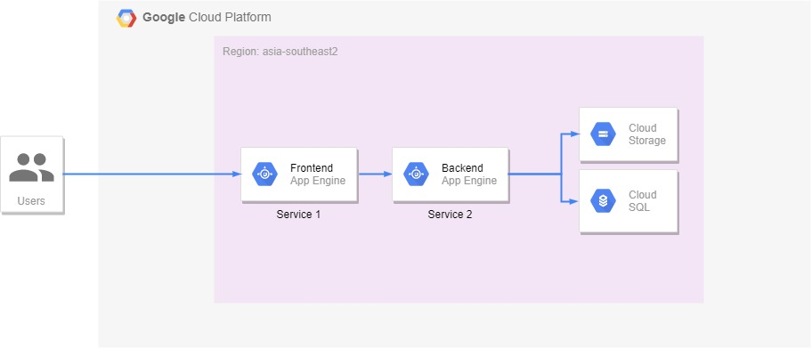
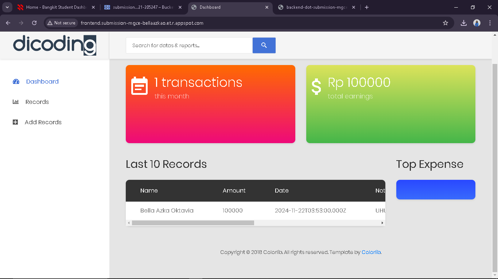
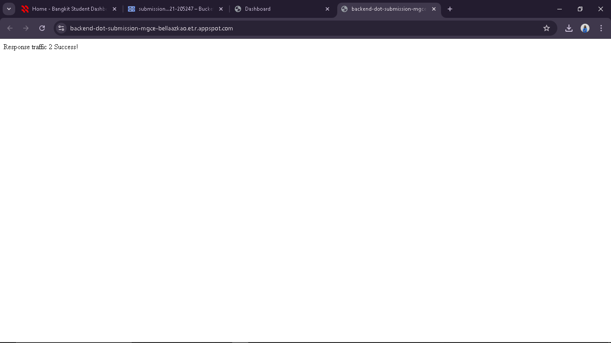

# 💰 Money Tracker

Aplikasi pencatatan keuangan (*Money Tracker*) berbasis arsitektur **Google Cloud Platform (GCP)** yang memisahkan layanan Frontend (PHP CodeIgniter) dan Backend API (Node.js Express), terintegrasi dengan Cloud SQL dan Google Cloud Storage.

Proyek ini dibuat untuk submission / tugas **Dicoding Google Cloud**.

---

## 📸 Screenshots & Arsitektur

### 1. Cloud Architecture (GCP)


### 2. Tampilan Aplikasi Frontend


### 3. Backend API


---

## 🏗️ Struktur Proyek

- **`a133-gcp-labs-money-tracker/`**: Web Frontend berbasis PHP (CodeIgniter) untuk antarmuka pengguna di Google App Engine.
- **`a133-gcp-labs-money-tracker-api/`**: Backend RESTful API berbasis Node.js Express untuk mengelola data transaksi di Cloud SQL (MySQL) dan upload file lampiran ke Cloud Storage (GCS).

---

## 🚀 Deployment (Google Cloud App Engine)

1. **Deploy Backend API:**
   ```bash
   cd a133-gcp-labs-money-tracker-api
   gcloud app deploy app.yaml
   ```

2. **Deploy Frontend:**
   ```bash
   cd ../a133-gcp-labs-money-tracker
   gcloud app deploy app.yaml
   ```

